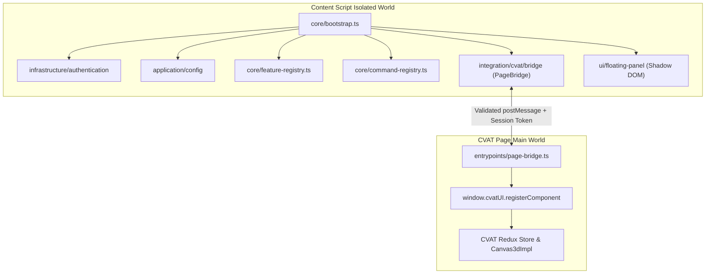

# Architecture — CVAT 3D Enhancer

## 1. Overview & Clean Architecture Layers

CVAT 3D Enhancer is a Chrome/Brave Manifest V3 browser extension designed to enhance the CVAT 3D/LiDAR annotation workspace without modifying or forking the CVAT source code.

## 2. Layer Responsibilities

1. **`src/entrypoints/`**:
   - `background.ts`: Configures `chrome.storage.session.setAccessLevel({ accessLevel: 'TRUSTED_CONTEXTS' })` and handles background origin validation messages.
   - `content.ts`: Bootstraps the extension in the isolated content-script world.
   - `page-bridge.ts`: Injected into the CVAT page context to interact with `window.cvatUI.registerComponent` and the active `Canvas3d` instance.
   - `popup/`: Extension action popup summarizing authorized origins and global settings.
2. **`src/core/`**:
   - `lifecycle-manager.ts`: Tracks every event listener, `MutationObserver`, and cleanup callback for deterministic teardown.
   - `feature-registry.ts`: Manages independent feature lifecycles and blocks features whose required runtime capabilities are unsupported.
   - `command-registry.ts`: Capability-gated command execution bus.
   - `event-bus.ts`: Typed pub/sub bus.
   - `logger.ts`: Automatic credential/header/cookie redacting logger.
3. **`src/integration/cvat/`**:
   - `detector/`: URL and DOM inspection for CVAT routes (`/tasks/:tid/jobs/:jid`) and 3D workspace containers.
   - `compatibility/`: Queries `/api/server/about` to detect CVAT server versions.
   - `bridge/`: Zod-validated request/response envelope protocol (`CVAT_3D_ENHANCER_BRIDGE_V1`).
   - `dom/`: Safe CSS property and WebGL `<canvas>` filter adapter.
   - `runtime/`: `CapabilityRegistry`, `CvatV2RuntimeAdapter`, and `RuntimeManager`.
4. **`src/application/`**:
   - `config/`: Hierarchical configuration manager (`Task > Project > Global > System Defaults`), Zod validation, schema migration, and JSON import/export.
   - `commands/`: Application-level commands wired to runtime capabilities.
5. **`src/infrastructure/`**:
   - `authentication/`: `CvatSessionProvider`, `PersonalAccessTokenProvider`, and `AuthenticationManager`.
   - `storage/`: `ChromeLocalStorageAdapter` for non-sensitive settings and `EphemeralSessionStorageAdapter` for session-only PAT storage.
6. **`src/ui/`**:
   - Isolated Shadow DOM Floating Panel with 6 tabs: Overview, Appearance, 3D Visualization, Annotation, Presets, and Advanced Settings.

## 3. Documented Architectural Refinements

- Added `scripts/check-secrets.mjs` to enforce automated secret and unsafe-execution static scanning during `npm run test:security`.
- Added `SECURITY.md` at the repository root in addition to `docs/security.md` to satisfy standard vulnerability disclosure conventions.
