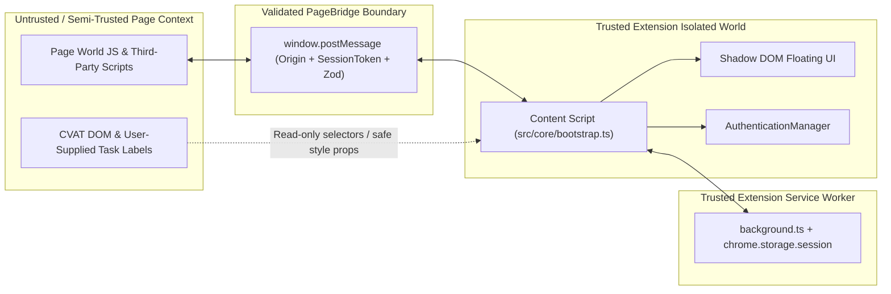

# Threat Model — CVAT 3D Enhancer

## 1. Assets

1. **CVAT User Session & Authentication Credentials**:
   - Browser session cookies (`sessionid`, `csrftoken`) managed by the browser for the CVAT origin.
   - Optional Personal Access Token (PAT) if supplied by the user for the current session.
2. **CVAT Annotation Integrity**:
   - 3D cuboid annotations, label assignments, and object states inside the active CVAT job.
3. **Extension Privileged Context**:
   - Content script isolated world, `chrome.storage.local` configuration store, `chrome.storage.session` ephemeral memory, and background service worker.
4. **User Privacy & Workspace Metadata**:
   - Task IDs, project IDs, job IDs, and custom visualization presets.

## 2. Trust Boundaries

## 3. Attack Surfaces

1. **`window.postMessage` Channel (`PageBridge`)**: Any script running in the CVAT webpage context can send `window.postMessage` events attempting to spoof commands or responses.
2. **CVAT DOM Content**: Task names, label names, or attributes rendered in the DOM could contain malicious HTML/JS payloads.
3. **Configuration Import JSON**: User-imported preset or configuration JSON files could contain XSS payloads, prototype pollution (`__proto__`), or oversized payloads.
4. **Origin & Network Requests**: Malicious pages or open redirects attempting to trick the extension into sending `Authorization` headers or session requests to untrusted origins.

## 4. Threat Actors

- **Malicious Webpage / Compromised Page Script**: Script executing in the main page world attempting to escalate privileges into the extension context or exfiltrate tokens.
- **Malicious Project/Task Creator**: A CVAT user who crafts malicious label names or shared preset JSON files to trigger DOM XSS in another annotator's browser.
- **Network Attacker (MITM)**: Attempting to intercept credentials over unencrypted HTTP connections.

## 5. Attack Scenarios & Mitigations

| ID | Attack Scenario | Mitigation Implemented | Verification Test |
| --- | --- | --- | --- |
| **TM-01** | Webpage script sends forged `window.postMessage` to invoke privileged extension actions or spoof runtime state. | Per-session cryptographic `sessionToken` generated via `crypto.getRandomValues`, stripped immediately from `<script>` dataset on load; strict `event.source === window` and `event.origin === window.location.origin` check; explicit `BRIDGE_COMMANDS` allowlist and Zod envelope validation. | `tests/security/security-suite.test.ts` (#1, #2, #9) |
| **TM-02** | Malicious configuration JSON import attempts Prototype Pollution (`{"__proto__": {"polluted": true}}`) or CSS/HTML XSS. | `safeJsonParse` reviver and `assertNoPrototypePollution` block `__proto__`, `constructor`, and `prototype`; `HexColorSchema` enforces `/^#[0-9a-fA-F]{6}$/`; preset names/descriptions reject `<` and `>`. | `tests/security/security-suite.test.ts` (#5, #12) |
| **TM-03** | Credential theft via `chrome.storage.local`, `localStorage`, DOM inspection, or console logs. | PATs are never stored in `chrome.storage.local` or `localStorage`; stored only in memory / `chrome.storage.session` (`TRUSTED_CONTEXTS`); never sent across `PageBridge`; `Logger` automatically redacts `Bearer`, `Token`, `Authorization`, `cookie`, and `pat` fields. | `tests/security/security-suite.test.ts` (#7, #8, #9) |
| **TM-04** | Cross-origin credential leakage or downgrade to plaintext HTTP. | `validateCvatOrigin` and `buildSafeCvatApiUrl` enforce HTTPS (allowing HTTP only on `localhost`/`127.0.0.1`), reject embedded URL credentials, and require membership in `DEFAULT_AUTHORIZED_ORIGINS`. | `tests/security/security-suite.test.ts` (#3, #4) |
| **TM-05** | Malicious CVAT DOM spoofing authentication state via `data-*` attributes. | `AuthenticationManager` never reads DOM attributes to determine authentication; always verifies via same-origin `/api/users/self`. | `tests/security/security-suite.test.ts` (#6) |

## 6. Residual Risks

1. **Same-Origin Compromise in Page World**: Because CVAT's `Canvas3d` instance lives in the page's JavaScript heap, a full XSS compromise of the CVAT web application itself could tamper with `window.cvatUI` visual state inside the page tab. However, because credentials and `chrome.*` APIs are isolated in the content script/service worker and never cross `PageBridge`, a page-world compromise cannot access extension storage or PATs.
2. **Optional Host Permissions**: If a user grants optional host permissions to a custom self-hosted HTTPS domain, the extension relies on the user's explicit authorization for that origin.
